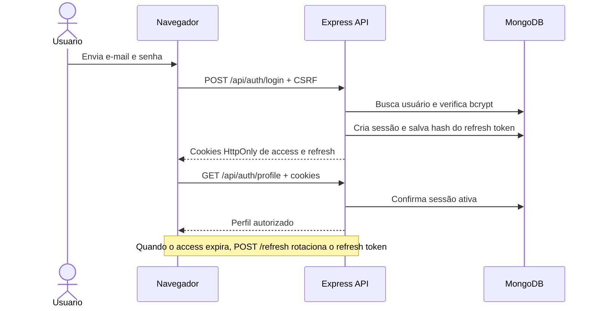

# Auth System

Projeto demonstrativo de autenticação full-stack. Ele oferece cadastro e login, protege o perfil e o dashboard e implementa recuperação de conta com sessões revogáveis. O objetivo é concentrar as decisões de autenticação no backend e evitar o armazenamento de credenciais de sessão acessíveis ao JavaScript do navegador.

## Funcionalidades

- Cadastro com validação de nome, e-mail normalizado e política de senha.
- Login com bcrypt, access JWT de 15 minutos e opção “Lembrar de mim”.
- Sessões de refresh token aleatórias, guardadas somente como hash, com rotação, detecção de reutilização e revogação individual/global.
- Cookies HttpOnly, `Secure` em produção, `SameSite=Lax` e proteção CSRF double-submit.
- Perfil e rota privada autenticados; dashboard servido por uma rota que verifica a sessão.
- Recuperação e redefinição de senha com token aleatório de uso único, guardado no banco somente como hash.
- Envio de e-mail SMTP; sem SMTP em desenvolvimento, o link é exibido no console como alternativa manual.
- Verificação opcional de e-mail, configurável por ambiente.
- Rate limiting persistente no MongoDB para cadastro, login, recuperação, redefinição e refresh; login limitado também por e-mail.
- Bloqueio temporário após falhas consecutivas de login, com mensagem genérica para reduzir enumeração de contas.
- Health check, encerramento gracioso, headers Helmet/CSP e CORS por allowlist.

## Tecnologias

- Node.js 20.19+ (CI em Node 20 e 22), Express 5 e Mongoose/MongoDB.
- JWT (`jsonwebtoken`), bcrypt, Nodemailer e Zod.
- Helmet, CORS, Pino/Pino HTTP.
- HTML, CSS e JavaScript vanilla.
- `node:test`, Supertest e MongoDB Memory Server.
- ESLint e Prettier; GitHub Actions para CI.

## Arquitetura

```text
public/                 Páginas e scripts do frontend
src/
  app.js                Configuração da aplicação Express, middleware e rotas
  server.js             Inicialização, conexão MongoDB e graceful shutdown
  config.js             Validação das variáveis de ambiente
  controllers/          Cadastro, login, sessões e recuperação
  middlewares/          CSRF, autenticação, validação, rate limit e erros
  models/               User, RefreshToken e RateLimitCounter
  routes/               Rotas HTTP de autenticação
  utils/                E-mail e logging
  validation/           Schemas Zod e política de entrada
test/                   Testes unitários e integração
```

O frontend faz chamadas same-origin. O cookie de access token é enviado às rotas `/api`; o refresh token é usado para renovar a sessão. O perfil confirma a validade da sessão no servidor, e o dashboard só é servido quando existe uma sessão ativa.

### Fluxo de autenticação



## Rotas

Todas as rotas `POST` exigem o cookie CSRF e o header `X-CSRF-Token`. “Sessão” indica access cookie válido; logout e refresh também exigem CSRF, mas não exigem access token.

| Método | Rota                            | Autenticação                   | Descrição                                         |
| ------ | ------------------------------- | ------------------------------ | ------------------------------------------------- |
| `GET`  | `/health`                       | Pública                        | Estado da aplicação e conexão com MongoDB         |
| `GET`  | `/dashboard.html`               | Sessão                         | Serve o dashboard ou redireciona ao login         |
| `POST` | `/api/auth/register`            | Pública + CSRF                 | Cria uma conta                                    |
| `POST` | `/api/auth/login`               | Pública + CSRF                 | Autentica e cria sessão                           |
| `POST` | `/api/auth/refresh`             | Refresh cookie + CSRF          | Rotaciona o refresh e renova o access             |
| `POST` | `/api/auth/logout`              | Refresh cookie opcional + CSRF | Revoga a sessão atual e limpa cookies             |
| `POST` | `/api/auth/logout-all`          | Sessão + CSRF                  | Revoga as sessões do usuário                      |
| `POST` | `/api/auth/forgot-password`     | Pública + CSRF                 | Solicita link de recuperação com resposta neutra  |
| `POST` | `/api/auth/reset-password`      | Pública + CSRF                 | Redefine senha usando token de uso único          |
| `POST` | `/api/auth/resend-verification` | Pública + CSRF                 | Solicita reenvio de verificação (resposta neutra) |
| `POST` | `/api/auth/verify-email`        | Pública + CSRF                 | Consome token de verificação de e-mail            |
| `GET`  | `/api/auth/profile`             | Sessão                         | Retorna dados públicos do perfil                  |
| `GET`  | `/api/auth/private`             | Sessão                         | Rota privada de exemplo                           |

## Como rodar

### 1. Instalar os pré-requisitos

Instale Node.js 20.19.0 ou superior e npm.

### 2. Escolher e iniciar o MongoDB

**Opção 1 — MongoDB Community Server local**

- **Windows:** instale o MongoDB Community Server pelo instalador oficial, habilite a instalação como serviço e confirme que o serviço MongoDB está iniciado.
- **macOS:** instale pelo Homebrew (`brew install mongodb-community`) e inicie o serviço com `brew services start mongodb-community`.
- **Linux:** instale o pacote Community Server adequado à distribuição e inicie o serviço com `sudo systemctl enable --now mongod`.

URI local padrão: `mongodb://127.0.0.1:27017/auth-system`.

**Opção 2 — MongoDB Atlas**

Crie um cluster gratuito, crie um usuário de banco de dados, libere o IP público do computador em **Network Access** e copie a connection string do cluster. Preencha os placeholders de usuário, senha, cluster e banco localmente; não compartilhe a URI.

### 3. Configurar o ambiente

Copie `.env.example` para `.env`:

```bash
copy .env.example .env
```

No macOS/Linux, use `cp .env.example .env`. Configure `MONGODB_URI` para a URI local ou Atlas e `JWT_SECRET` com o valor gerado localmente; armazene-o somente no `.env` ou em um secret manager. Como referência de formato, use `JWT_SECRET=<gere-um-valor-aleatorio-de-pelo-menos-32-caracteres>` e substitua o placeholder antes de iniciar o sistema. Consulte a tabela abaixo para as demais variáveis e nunca compartilhe o `.env`.

Gere um segredo aleatório localmente com:

```bash
node -e "console.log(require('crypto').randomBytes(48).toString('base64url'))"
```

| Variável                                                        | Descrição                                                                            |
| --------------------------------------------------------------- | ------------------------------------------------------------------------------------ |
| `MONGODB_URI` / `MONGO_URI`                                     | URI MongoDB local ou Atlas; uma delas é obrigatória                                  |
| `JWT_SECRET`                                                    | Segredo de assinatura com pelo menos 32 caracteres                                   |
| `RESET_PASSWORD_URL`                                            | URL base de redefinição; obrigatória em produção                                     |
| `PORT`                                                          | Porta HTTP, padrão 3000                                                              |
| `LOG_LEVEL`                                                     | Nível do logger Pino, padrão `info`                                                  |
| `CORS_ORIGINS`                                                  | Origens HTTP(S) permitidas, separadas por vírgula                                    |
| `SMTP_HOST`, `SMTP_PORT`, `SMTP_USER`, `SMTP_PASS`, `MAIL_FROM` | Configuração SMTP; todas obrigatórias em produção e opcionais em conjunto fora dela  |
| `REFRESH_TOKEN_SHORT_TTL_DAYS`                                  | Validade de refresh sem “Lembrar de mim”, padrão 1 dia                               |
| `REFRESH_TOKEN_LONG_TTL_DAYS`                                   | Validade de refresh com “Lembrar de mim”, padrão 30 dias                             |
| `TRUST_PROXY`                                                   | Proxy(s) confiável(is): `false`, `true`, saltos ou IPs/CIDRs                         |
| `RATE_LIMIT_WINDOW_MS`                                          | Janela do rate limit, padrão 15 minutos                                              |
| `LOGIN_RATE_LIMIT_MAX`, `LOGIN_EMAIL_RATE_LIMIT_MAX`            | Limites de login por IP e por e-mail                                                 |
| `REGISTER_RATE_LIMIT_MAX`                                       | Limite de cadastro por IP e por e-mail                                               |
| `FORGOT_PASSWORD_RATE_LIMIT_MAX`                                | Limite de recuperação por IP/e-mail                                                  |
| `EMAIL_VERIFICATION_RATE_LIMIT_MAX`                             | Limite dedicado de reenvio de confirmação por IP e por e-mail, padrão 3              |
| `RESET_PASSWORD_RATE_LIMIT_MAX`                                 | Limite de redefinição por IP e por hash do token; verificação por IP                 |
| `REFRESH_RATE_LIMIT_MAX`                                        | Limite de renovação de sessão por IP                                                 |
| `LOGIN_MAX_FAILED_ATTEMPTS`                                     | Falhas consecutivas antes do bloqueio temporário                                     |
| `LOGIN_BLOCK_DURATION_MINUTES`                                  | Duração do bloqueio temporário                                                       |
| `EMAIL_VERIFICATION_ENABLED`                                    | Habilita confirmação (`true`/`false`; template usa `true`, padrão do código `false`) |
| `EMAIL_VERIFICATION_TTL_HOURS`                                  | Validade do token de verificação, padrão 24 horas                                    |

### Configurar e-mail de confirmação

A confirmação só é exigida quando `EMAIL_VERIFICATION_ENABLED=true`. Se a variável estiver ausente ou definida como `false`, o cadastro marca o e-mail como verificado e o endpoint de reenvio mantém uma resposta neutra sem enviar mensagem.

Escolha uma opção abaixo e configure o conjunto completo `SMTP_HOST`, `SMTP_PORT`, `SMTP_USER`, `SMTP_PASS` e `MAIL_FROM` no `.env`. Não inclua credenciais neste README, em issues ou no repositório.

**Mailtrap para testes**

1. Crie uma inbox SMTP de teste no Mailtrap e consulte nela os valores de conexão.
2. Configure `SMTP_HOST`, `SMTP_PORT`, `SMTP_USER` e `SMTP_PASS` com os valores indicados pela inbox; defina `MAIL_FROM` como remetente de teste.
3. Mantenha o envio restrito à inbox/sandbox do Mailtrap, que captura os e-mails em vez de entregá-los a destinatários reais.
4. Defina `EMAIL_VERIFICATION_ENABLED=true`, reinicie `npm run dev` e use **Reenviar confirmação de e-mail** na tela de login. Confira a mensagem na inbox do Mailtrap.

**Gmail para envio real**

1. Ative a verificação em duas etapas na conta Google e gere uma senha de app. Não use a senha normal da conta.
2. Configure `SMTP_HOST=smtp.gmail.com`, `SMTP_PORT=465` (TLS) ou `587` (STARTTLS), `SMTP_USER` com o endereço Gmail, `SMTP_PASS` com a senha de app e `MAIL_FROM` com remetente autorizado.
3. Defina `EMAIL_VERIFICATION_ENABLED=true` e reinicie o servidor. Em produção, configure também `RESET_PASSWORD_URL` para o domínio HTTPS correto e guarde credenciais em um secret manager.

Sem SMTP configurado fora de produção, o link de confirmação é impresso no console apenas para desenvolvimento local. Ele contém um token de uso único: não compartilhe esse log. Em produção o fallback não é usado. Falhas SMTP registram diagnóstico sanitizado com host/porta e orientação para checar rede ou autenticação, sem registrar credenciais, destinatário ou link.

### 4. Instalar dependências e iniciar

```bash
npm install
npm run dev
```

Abra `http://localhost:3000` e confira `http://localhost:3000/health`. Para iniciar sem nodemon, use `npm start`.

O servidor configura timeout de seleção de servidor de cinco segundos. Se o banco estiver inacessível, registra uma mensagem em português indicando o que verificar; `/health` informa estado degradado e as rotas `/api` respondem 503 até a conexão ser restabelecida.

## Ver o projeto no navegador

Com o MongoDB configurado e acessível, execute:

```bash
npm run dev:chrome
```

O comando inicia o servidor com nodemon, aguarda `/health` indicar conexão saudável com o banco por até 30 segundos e então abre o Google Chrome. Se não localizar o Chrome, tenta abrir o navegador padrão. Confirme visualmente:

- Abrir `/health` e verificar o estado do banco.
- Cadastrar uma conta, fazer login e acessar o dashboard.
- Em **F12 > Application > Cookies**, conferir `HttpOnly` no cookie de sessão; em **Local Storage**, confirmar ausência de tokens.
- Em **F12 > Network > requisição > Response Headers**, conferir `Content-Security-Policy`, `X-Content-Type-Options`, `Strict-Transport-Security` em produção e ausência de `X-Powered-By`.
- Em **F12 > Console**, verificar ausência de violações de CSP por scripts inline.
- Tentar login incorreto repetidamente e observar a resposta genérica, o rate limit e o bloqueio temporário.

## Problemas comuns

- **`ECONNREFUSED`:** verifique se o serviço local está em execução e se host/porta na URI estão corretos; no Atlas, confirme o cluster.
- **Falha de autenticação:** confirme usuário e senha do banco, codifique caracteres especiais na URI e não confunda a conta do Atlas com o usuário do banco.
- **IP não liberado no Atlas:** adicione o IP público atual em **Network Access** e aguarde a propagação.
- **`JWT_SECRET` curto:** gere localmente um novo segredo aleatório com o comando acima; configure-o apenas no ambiente seguro e reinicie o serviço.
- **Porta em uso:** escolha uma porta livre configurando `PORT` ou encerre o processo que já está usando a porta.

## Testes

Os testes unitários e de integração não precisam de uma instalação externa de MongoDB: a integração usa MongoDB Memory Server.

```bash
npm test
```

Em desenvolvimento sem SMTP, os links de recuperação/verificação são impressos no console para uso manual. Restrinja o acesso a esses logs.

## Testes, lint e formatação

```bash
npm test
npm run test:coverage
npm run lint
npm run format
```

Os testes de integração usam MongoDB Memory Server; a primeira execução pode baixar o binário do MongoDB. A cobertura nativa do Node é informativa e não impõe um limite mínimo.

## Decisões e limitações de segurança

- Senhas usam bcrypt com custo 12; senha e hashes de tokens ficam ocultos nas consultas padrão.
- Access JWT curto e refresh opaco, de uso rotativo, ficam em cookies HttpOnly; não são persistidos em `localStorage` ou `sessionStorage`.
- Refresh reutilizado revoga sua família de sessão; reset de senha invalida as sessões existentes.
- CSRF usa cookie double-submit e header customizado, com `SameSite=Lax`; CORS não permite wildcard com credenciais.
- Rate limits são persistidos em MongoDB; IP, e-mail e token de redefinição são indexados como HMAC. Para instalações multi-região com grande volume, avalie um store dedicado como Redis.
- Pino HTTP gera request ID e omite query string e headers do registro de request; campos sensíveis também são redacted. A saída de link no modo SMTP ausente é uma exceção intencional de desenvolvimento, necessária para o fluxo manual de recuperação e deve permanecer inacessível a terceiros.
- Operadores MongoDB e chaves com ponto são rejeitados antes dos endpoints; parâmetros repetidos na query da API são recusados para evitar HTTP Parameter Pollution.
- O logger registra eventos de falha de login, bloqueio, replay de refresh, reset concluído e rate limit excedido sem incluir credenciais ou identificadores do usuário.
- E-mail de verificação está desabilitado por padrão; configure SMTP e domínio antes de ativá-lo em produção.
- Não há 2FA, CAPTCHA, detecção de credenciais comprometidas nem testes end-to-end em navegador.
- O dashboard é protegido na rota de entrega, mas os arquivos estáticos do frontend não são conteúdo confidencial; dados privados devem continuar atrás da API autenticada.
- Não há outbox durável para e-mail. Uma falha de envio após emitir o token requer nova solicitação.
- Em produção, configure TLS no proxy, `TRUST_PROXY` apenas para proxies confiáveis, CORS com origens exatas, SMTP e um domínio público correto para redefinição.

## Captura de tela

Ainda não incluída. Adicione uma captura real em `docs/screenshots/auth-system-preview.png` se quiser exibir a interface nesta documentação.

## Segurança

Consulte [SECURITY.md](./SECURITY.md) para relatar vulnerabilidades.

## Licença

Este projeto está licenciado sob a [licença ISC](./LICENSE).
